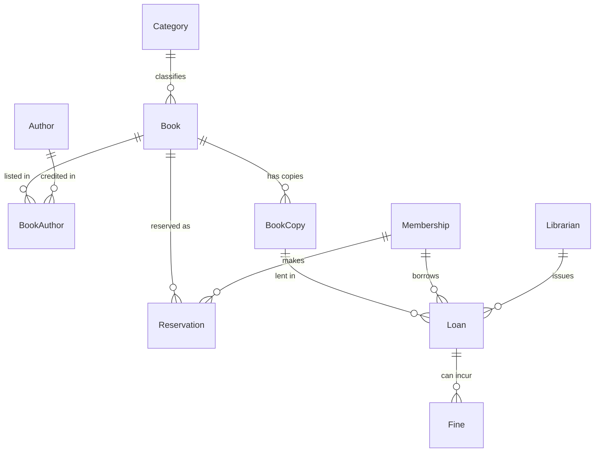

<h1 align="center">Community Library & Book Lending System</h1>

  <b>Library Database</b> · MS SQL Server

  
  
  

---

## The problem

A community library needs to know who has borrowed which copy of a book, when it is due, who is waiting for a title, and which fines are still unpaid.

This database models that: books and their physical copies, authors, members, librarians, loans, reservations and fines.

## Where this project is

| Done | Still to do |
|---|---|
| ERD designed | Sample data |
| T-SQL schema written: 10 tables with keys and constraints | Queries and views for reporting |
| | Business rules that need code, such as updating a copy's status when it is lent |

## Data model

## Design decisions

| Decision | Why |
|---|---|
| **`Book` separate from `BookCopy`** | A title can have many physical copies, and a loan needs to point at the exact copy that was lent |
| **`BookAuthor` junction table** | A book can have several authors and an author several books |
| **Reservations on `Book`, loans on `BookCopy`** | A member waits for a title, but borrows one specific copy |
| **`Librarian` recorded on every `Loan`** | Each loan shows who issued it |
| **`Fine` linked to `Loan`** | A fine is always tied to the loan that caused it |
| **CHECK constraints** | Business rules enforced in the database: 13-character ISBN, valid statuses and conditions, due date not before loan date, fines of 0 or more |
| **Defaults** | Dates default to today and statuses to `Available`, `Active`, `Pending` and `Unpaid` |

## What's inside

| File | Purpose |
|---|---|
| `LibrarySystem.sql` | The 10 tables, with keys, constraints and defaults |

## Run it yourself

1. Create a database called `LibrarySystem` in SQL Server Management Studio or Azure Data Studio.
2. Run `LibrarySystem.sql`.

---

  Part of my portfolio · <a href="https://rabogale-matjokotja.github.io">rabogale-matjokotja.github.io</a>

